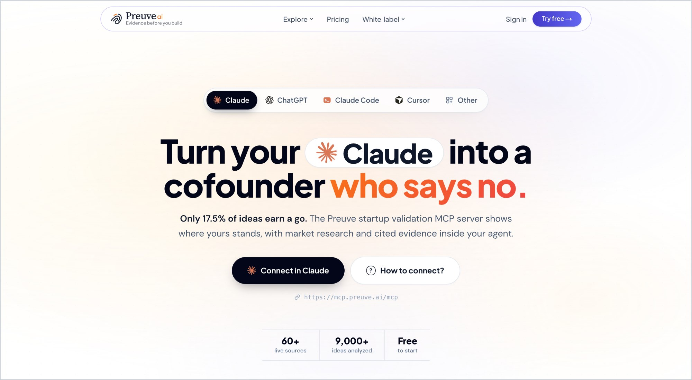

<div align="center">

# Preuve AI · MCP server and API

### Market research and competitive intelligence your agent runs before it builds.

Turn Claude, Cursor or Codex into a cofounder who says no. One tool call runs a startup idea through 60+ live sources and returns a verdict that has to be earned, the real competitors, the market size, and the source behind every figure.

[](https://claude.ai/directory/preuve-ai)
[](https://preuve.ai/mcp?utm_source=github&utm_medium=readme&utm_campaign=api-readme)
[](https://preuve.ai/openapi.json)
[](https://preuve.ai/mcp?utm_source=github&utm_medium=readme&utm_campaign=api-readme)

</div>

<p align="center">
  <a href="https://preuve.ai/mcp?utm_source=github&utm_medium=readme&utm_campaign=api-readme">
    
  </a>
</p>

Last updated: 15 Oct 2026. Maintained by Vincent Forat, who builds Preuve AI.

## 🎯 Why is the score worth reading?

Generic AI cheers every idea. A Preuve score has to be earned, and you can check how it was earned.

- ⚖️ **It is hard to earn.** Across 6,000+ analyses the median idea scored 54/100. Only 17.5% cleared 70, the line for a go. 76.0% got a caution and 6.4% a no-go. ([July 2026 benchmark](https://preuve.ai/blog/startup-validation-benchmarks-2026))
- 🧾 **It stands on evidence, not on enthusiasm.** Six factors (market, demand, competition, moat, business model, regulatory risk), each scored against live sources pulled for that run, then cross-checked across models. When runs disagree, the analysis reruns until the verdict is stable.
- 🔍 **You can audit it.** Every sourced figure links to its page. A paid report carries a median of 70 links across 40+ domains. What the engine could not verify is labeled unverified.
- 🧭 **It tells you what moves it.** The report names the risk pulling the score down, then gives 3 Smart Pivots to lift it. 82% of re-scored versions went up.

A real starter scan, as your agent sees it ([open the report](https://preuve.ai/share/p0Y8vGqy?utm_source=github&utm_medium=readme&utm_campaign=api-readme)):

```text
● preuve · start_analysis("SecondScreen OS", "starter")
  SCORE      48 / 100
  VERDICT    CAUTION
  RIVALS     Discord  +4 mapped
  TOP RISK   go-to-market
✓ starter scan complete · preuve.ai/share/p0Y8vGqy
```

## 📌 At a glance

<table>
  <tr><td width="200">💡 <b>What it does</b></td><td>Your agent checks the market before it writes code: demand, competitors, market size and risks, from 60+ live sources</td></tr>
  <tr><td width="200">🧨 <b>Problem it solves</b></td><td>Agents say yes and start scaffolding. Founders ship products nobody wants because generic AI cheers every idea</td></tr>
  <tr><td width="200">👥 <b>Who uses it</b></td><td>Founders and vibe coders building with Claude, Cursor or Codex. Agencies, accelerators and consultants who pre-qualify inbound startups under their own brand</td></tr>
  <tr><td width="200">🧠 <b>Engine</b></td><td>10 research agents on 60+ live sources (Crunchbase, Reddit, G2, Google Trends, SEC EDGAR). Deep scans run on Claude Opus 5.5</td></tr>
  <tr><td width="200">💸 <b>Pricing</b></td><td>Starter scans are free. Deep scans use the quota your plan already has. No separate API fee</td></tr>
  <tr><td width="200">📈 <b>Track record</b></td><td>9,000+ ideas analyzed</td></tr>
</table>

## 🔌 How do I connect the MCP server?

Connector URL: `https://mcp.preuve.ai/mcp` (remote, Streamable HTTP). OAuth sign-in creates a free account and mints the key for you. Nothing to paste.

**claude.ai** (web, desktop, mobile): one click from the [Claude Connectors Directory](https://claude.ai/directory/preuve-ai). Sign in, press Allow. Works on the free plan.

**Claude Code**: add the server, then type `/mcp`, pick `preuve` and sign in.

```bash
claude mcp add --transport http preuve https://mcp.preuve.ai/mcp
```

**Codex**: add the server, then press Allow in the browser.

```bash
codex mcp add preuve --url https://mcp.preuve.ai/mcp
codex mcp login preuve
```

**Cursor**: add this to `~/.cursor/mcp.json`. Cursor opens the sign-in the first time it connects.

```json
{ "mcpServers": { "preuve": { "url": "https://mcp.preuve.ai/mcp" } } }
```

**Any other MCP client**: a client that only takes a header sends `Authorization: Bearer prv_YOUR_KEY`. Creating a key by hand is self-serve on a paid plan: https://preuve.ai/app?settings=apiKeys. A client with no remote HTTP support can bridge with `npx -y mcp-remote https://mcp.preuve.ai/mcp`.

Then ask your agent:

> Validate this startup idea with Preuve: [your idea]. Start with a free starter scan, then walk me through the verdict, competitors, and biggest risk.

## 🛠️ Which tools does the MCP server have?

| Tool | What it does |
|---|---|
| `start_analysis` | Starts one run. `scanType` is required: `starter` is free, `deep` spends paid quota, so an agent never spends by accident |
| `get_analysis` | Polls a run: status, report URL, share URL, module progress |
| `enrich_analysis` | Fills missing core sections, can start the deep modules |
| `export_analysis` | Structured `ideas-json` export of a finished run |
| `generate_ideas` | Startup ideas built around your interests. 5 free per 24 hours, spends no scan quota |
| `get_agency` | Client work on a Consultant or Agency workspace |

## ⚡ How do I call the API?

One header, `x-preuve-key`. No request signing.

```bash
curl -X POST https://preuve.ai/api/agent/analyses \
  -H "x-preuve-key: prv_YOUR_KEY" \
  -H "content-type: application/json" \
  -d '{"clientRunId":"first-run-001","scanType":"starter","idea":"An iPad app for solo therapists that records a session and drafts the SOAP note on-device. No audio leaves the hardware."}'
```

Poll until `status` is `COMPLETED`:

```bash
curl https://preuve.ai/api/agent/analyses/RUN_ID -H "x-preuve-key: prv_YOUR_KEY"
```

`clientRunId` is the idempotency key: send the same value again and you get the same run back. Discovery document, no auth needed: https://preuve.ai/api/agent. OpenAPI: https://preuve.ai/openapi.json

## 🆚 Starter scan vs deep scan

| | ⚡ Starter | 🔬 Deep |
|---|---|---|
| Cost | Free | Spends the account's paid quota |
| Time | Under a minute | About ten minutes |
| You get | Score, top risks, 2 competitors | Full report: up to 15 competitors with links, market sizing, revenue model, first-100-customers plan, 3 Smart Pivots, citations |
| Optional modules | None | Proof of Demand, Founder Fit, Playbook, Trends, Community |
| Export | ideas-json | ideas-json with full sections, pivots, citations and module payloads |

## 🔑 Key facts for developers

- 13 endpoints, one header (`x-preuve-key`), no request signing. OpenAPI spec: https://preuve.ai/openapi.json
- 6 MCP tools over the same API. Remote Streamable HTTP at `https://mcp.preuve.ai/mcp` with OAuth sign-in, plus a local stdio server.
- Rate limits: 10 run creations per minute per account, 3 starter and 2 deep analyses in flight, batches of up to 5 ideas. A 429 carries a Retry-After header.
- Built for agent access: a documented HTTP API with an OpenAPI spec, a remote MCP server with OAuth, an official Claude connector and an [agent skill](https://docs.preuve.ai/agent-skill). Checked 15 Oct 2026: IdeaProof (ideaproof.io) and ValidatorAI (validatorai.com) publish no API page and no MCP page.

## 🚧 What this API does not do

- No logos, brand kits or ad copy. One job: should you build this.
- Enrich and export work only on runs this API started. A report made on the preuve.ai dashboard answers 403 REPORT_NOT_FROM_AGENT_RUN; polling it still works.
- No deep scan without paid quota on the account. The API never bills on its own.
- Rate limits apply per account, see Key facts. A rolling 24h creation ceiling answers 429 DAILY_LIMIT_REACHED with a resetAt.

## ❓ FAQ

**Is the score just an LLM's opinion?**
No. A chat model asked to rate an idea tends to agree with you. Preuve scores six factors against live evidence pulled for that run, cross-checks across models, and holds a strict scale: median 54, 17.5% go. The score is a read on today's market evidence, not a probability of success.

**Is the Preuve AI API free?**
The starter scan is free and returns a real report. Deep scans spend the paid quota your account already has. There is no separate API billing.

**Do I need an API key for the MCP server?**
No. Add `https://mcp.preuve.ai/mcp` as a connector and sign in with OAuth; that mints a key on a free account. Manual key creation is self-serve on a paid plan.

**Which clients work with the Preuve MCP server?**
claude.ai through the official connector, Claude Code, Cursor, Codex, and any HTTP MCP client. A local stdio server is also available.

**How often does Preuve say go?**
17.5% of 6,000+ analyses in the July 2026 benchmark. 76.0% got a caution and 6.4% a no-go.

**Where does each figure come from?**
Each market figure carries its source link. A paid report holds a median of 70 clickable links across 40+ domains. Anything the engine could not verify is labeled unverified.

**Is there an OpenAPI spec?**
Yes: https://preuve.ai/openapi.json and https://preuve.ai/openapi.yaml. The unauthenticated discovery document is https://preuve.ai/api/agent.

## 🔗 Links

- 🌐 Website: https://preuve.ai
- 🤖 MCP landing: https://preuve.ai/mcp
- 📚 Docs: https://docs.preuve.ai/
- 🔌 MCP server setup: https://docs.preuve.ai/mcp-server
- ⚡ HTTP API quickstart: https://docs.preuve.ai/quickstart
- 📖 API reference: https://docs.preuve.ai/api-reference/introduction
- 🧠 Agent skill: https://docs.preuve.ai/agent-skill
- 📊 Benchmark, 6,000+ analyses: https://preuve.ai/blog/startup-validation-benchmarks-2026
- 📄 Example report: https://preuve.ai/share/ElzWppux?utm_source=github&utm_medium=readme&utm_campaign=api-readme

---

<p align="center">
  <b>Preuve AI. Evidence before you build.</b><br/>
  <a href="https://preuve.ai/mcp?utm_source=github&utm_medium=readme&utm_campaign=api-readme">Connect your agent →</a>
</p>
